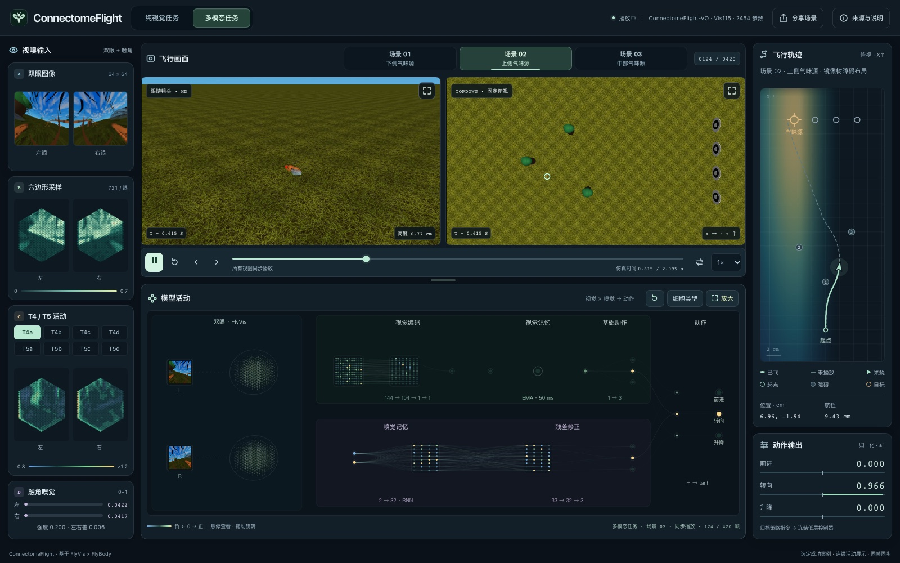

<div align="center">
  
</div>

<h1 align="center">ConnectomeFlight</h1>

<p align="center"><strong>A synchronized observatory for connectome-constrained fly navigation.</strong></p>

<p align="center">
  <a href="https://zhaofanbo.com/ConnectomeFlight-Web/"></a>
  
  <a href="https://github.com/FanboZhao/ConnectomeFlight-Web/actions/workflows/deploy-pages.yml"></a>
  <a href="LICENSE"></a>
</p>

<p align="center"><a href="https://zhaofanbo.com/ConnectomeFlight-Web/"><strong>Open the live observatory →</strong></a></p>

ConnectomeFlight is a browser-based observatory for two embodied navigation policies: a **pure visual** fly and a **visuo-olfactory** fly. Each task offers three selectable flight replays. The page keeps both cameras, the raw eye and antennal inputs, the trajectory, the model's internal activity and its actions on the same frame.

Everything is a frozen replay. The browser does not run the policy, call a server, or train anything.

## Highlights

- **Two tasks, three scenes each.** Compare different obstacle layouts, goal positions and flight routes under the same model.
- **Synchronized views.** Follow camera, top-down camera, eyes, T4/T5 activity, odor field, trajectory and action readouts share one timeline.
- **Real model activity.** Frozen FlyVis networks and policy units are sampled on their true hexagonal coordinates; hover for values and drag to rotate.
- **Built for inspection.** Frame stepping, speed control, looping, deep links to a scene and frame, model-graph zoom, and keyboard navigation.
- **Responsive.** Desktop, tablet and mobile layouts, with 44 px primary touch targets.

## Scenes

| Task | Scene | Geometry | Frames |
| --- | --- | --- | --- |
| D3 · visual | 01 | Upper spherical goal, five tree obstacles | 197 |
| D3 · visual | 02 | Central spherical goal, four tree obstacles | 194 |
| D3 · visual | 03 | Lower spherical goal, five tree obstacles | 213 |
| D4 · visuo-olfactory | 01 | Lower odor source | 417 |
| D4 · visuo-olfactory | 02 | Upper odor source, mirrored tree layout | 420 |
| D4 · visuo-olfactory | 03 | Central odor source, different tree layout | 399 |

Use `?task=D4&scene=2` to open a scene directly, and `&frame=220` to start at a frame.

## Models

| Task | Display model | Trainable parameters | Sensory path | Readout |
| --- | --- | --- | --- | --- |
| D3 | ConnectomeFlight-V | 115 | 32 × 32 binocular RGB | T4/T5 → 144 → fixed 104 compression → 50 ms EMA → actions |
| D4 | ConnectomeFlight-VO | 2454 | 64 × 64 binocular RGB + two antennal odor channels | Vis115 visual base + 32-d odor RNN + residual head |

Both models are exported from the **ConnectomeFlight** research repository. This repository contains only presentation data: the web interface, rendered frames, quantized appearance textures, display geometry and rounded replay readouts. Model weights, biases and precise intermediate arrays are not part of this repository.

## Local preview

No build step and no dependencies beyond Python 3:

```sh
python3 serve.py
# → http://127.0.0.1:8091/
```

The server supports HTTP range requests so the MP4s seek correctly.

## Repository layout

```text
dist/                 the site: HTML, CSS, JS, six replays and display JSON
assets/preview.jpg    repository preview image
LICENSES/             retained third-party notices
serve.py              local preview server
.github/workflows/    deployment and presentation-boundary checks
```

Each scene ships as one H.264 video (two cameras side by side), one RGBA appearance texture for the interactive model graph, and one display JSON with the rounded trajectory, actions, markers and layout. The deployment workflow validates the file boundary, JSON schema, frame counts and PNG bounds before publishing.

## Using the page

- Play/pause with the transport or <kbd>Space</kbd>; step with <kbd>←</kbd> / <kbd>→</kbd>.
- Switch task and scene with the top controls; arrow keys and <kbd>Home</kbd> / <kbd>End</kbd> move through scenes.
- Drag the model graph to rotate it; use the expand button for a full view.
- Share a scene or a specific frame from **分享场景**.
- Click any camera to enlarge it; <kbd>Esc</kbd> closes dialogs.

## Data policy

This is a presentation repository. It intentionally excludes checkpoints, learned parameters, normalization statistics, training code, experiment logs and precise hidden-state arrays. Appearance textures are quantized for display; they are not a numerical record of the model. The private research archive keeps the full numerical evidence.

## Attribution

Visual model and connectome: **FlyVis** (Lappalainen et al., *Nature* 634, 1132–1140, 2024). Body and low-level controller: **FlyBody** (Vaxenburg et al., *Nature* 643, 1312–1320, 2025). Interface references: [fly-brain](https://github.com/Lulzx/fly-brain) and [Neural Canvas](https://huggingface.co/spaces/Xenova/fruit-fly-simulation).

Activity images show continuous model responses, not biological spikes or a complete anatomical brain. Selected successful replays do not establish aggregate performance or independent generalization. See [ATTRIBUTION.md](ATTRIBUTION.md) for details and retained notices.

## License

The website code and presentation media in this repository are released under the [MIT License](LICENSE). Upstream FlyVis, FlyBody and third-party components retain their original licenses; see [LICENSES/](LICENSES/) and [ATTRIBUTION.md](ATTRIBUTION.md).

## 中文简介

ConnectomeFlight 是数字果蝇视觉与视嗅导航研究的展示站点。纯视觉与视嗅两个任务各提供三个可选回放，双镜头、双眼/触角输入、飞行轨迹与模型活动同帧同步。页面只播放冻结回放，不运行策略推理。本仓库仅包含网页、渲染画面、量化显示贴图与取整后的回放数据，不包含模型权重或训练代码。
